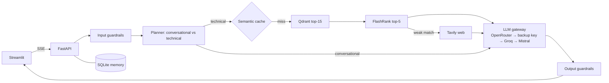

# Enterprise RAG

LangChain-based RAG with **FastAPI** (API) and **Streamlit** (UI).

- **LLM chain:** OpenRouter → OpenRouter (backup key) → Groq → Mistral, with circuit breakers
- **Vectors:** Qdrant Cloud
- **Embeddings:** HuggingFace API, with the *same model* run locally as fallback
- **Retrieval:** vector search (top 15) → FlashRank cross-encoder rerank (top 5)
- **Extras:** Tavily web fallback, semantic cache, persistent memory, guardrails

## Architecture



## Quick start

```bash
python -m venv .venv && source .venv/bin/activate     # Windows: .venv\Scripts\activate
pip install -r requirements.txt
cp _env .env            # or: cp .env.example .env and fill in keys
# put your documents (pdf, docx, md, txt, html, csv, json, yaml) in ./data  (e.g. unzip DOCS.zip into data/)

python scripts/ingest.py                      # index ./data into Qdrant (idempotent)
uvicorn app.main:app --port 8000              # terminal 1: API  (docs: http://localhost:8000/docs)
streamlit run ui/streamlit_app.py             # terminal 2: UI   (http://localhost:8501)
```

Docker: `docker compose up --build` (API on :8000, UI on :8501).

## How the fallback works

Providers without a key are skipped. For each request the gateway tries healthy providers in order.

| Situation | Behaviour |
|---|---|
| Error, 429 or timeout before the first token | Next provider is tried immediately |
| Failure mid-stream | A `reset` event is sent, the UI discards the partial text, the next provider restarts the answer |
| 3 consecutive failures | Provider is skipped for 60s (circuit breaker), then probed again |
| 401/403 (bad key) | Provider is skipped for 10 minutes |
| All providers down | HTTP 503 with per-provider error details |

Every response reports the provider and model that answered. `GET /v1/providers` shows breaker state and counters.

Embeddings: HF API failure → local `fastembed` runs **the same model**, so vectors stay compatible. Switching to a different embedding model needs a new collection (the app refuses to start on a dimension mismatch).

## API

All `/v1/*` routes need the `X-API-Key` header if `API_AUTH_KEY` is set.

| Method | Path | Purpose |
|---|---|---|
| POST | `/v1/chat` | Blocking answer (JSON) |
| POST | `/v1/chat/stream` | SSE events: `status`, `token`, `reset`, `final`, `error` |
| POST | `/v1/ingest/upload` | Upload files, returns a background job |
| POST | `/v1/ingest/directory` | Index `DATA_DIR` (or a sub-path) |
| GET | `/v1/ingest/jobs/{id}` | Job progress |
| GET / DELETE | `/v1/documents` | List or remove indexed documents |
| GET / DELETE | `/v1/threads[/{id}]` | Conversation history |
| GET | `/v1/providers` | LLM breaker state, reranker, cache stats |
| GET | `/health`, `/ready` | Liveness / readiness (Qdrant check) |

```bash
curl -N localhost:8000/v1/chat/stream -H 'content-type: application/json' \
  -d '{"message":"How does the semantic cache work?"}'
```

## Notable behaviours

- **Planner:** a first message of more than 6 words skips the routing LLM call, which saves a round trip.
- **Semantic cache:** stored in a second Qdrant collection. Only self-contained, document-grounded answers are cached (never web-based ones). It is flushed on every ingest or delete.
- **Grounding:** if the best rerank score is below `MIN_RELEVANCE_SCORE` and Tavily is configured, web results are added. Otherwise the answer is flagged low-confidence in the UI.
- **Guardrails:** deterministic and cost-free: prompt-injection patterns, secret/card/ID redaction (optional e-mail/phone via `REDACT_PII=true`), neutralisation of instructions hidden in retrieved documents, a system-prompt canary leak check, and secret scrubbing of output and logs.
- **Ingestion:** SHA-256 change detection, replace-on-change, and one bad file never stops a batch.
- **Security:** constant-time API-key check, rate limiting, upload size/extension limits, path-traversal-safe filenames, `/docs` disabled when `APP_ENV=production`.

## Tuning (see `app/config.py`, every field is an env var)

`RETRIEVAL_TOP_K`, `RERANK_TOP_N`, `MIN_RELEVANCE_SCORE`, `CHUNK_SIZE` / `CHUNK_OVERLAP`, `SEMANTIC_CACHE_THRESHOLD`, `OPENROUTER_MODEL`, `OPENROUTER_FALLBACK_MODEL`, `GROQ_MODEL`, `MISTRAL_MODEL`.

`MIN_RELEVANCE_SCORE` (reranker scores) and `SEMANTIC_CACHE_THRESHOLD` depend on your data. Tune them with `python scripts/evaluate.py eval/golden.example.jsonl` (retrieval hit-rate, keyword recall, latency).

## Tests

```bash
pip install -r requirements-dev.txt && pytest
```

46 offline tests (fake LLMs and embeddings, in-memory Qdrant) cover the fallback chain, circuit breaker, mid-stream recovery, guardrails, ingestion, cache, web fallback, API auth/rate limit/upload and SSE.

## Scaling notes

Run **one** uvicorn worker per container (breaker state, rate limiter and job registry are in-process). Scale by adding containers. For multi-instance deployments, move rate limiting and memory to Redis/Postgres (`ChatMemory` is a small class to swap).
